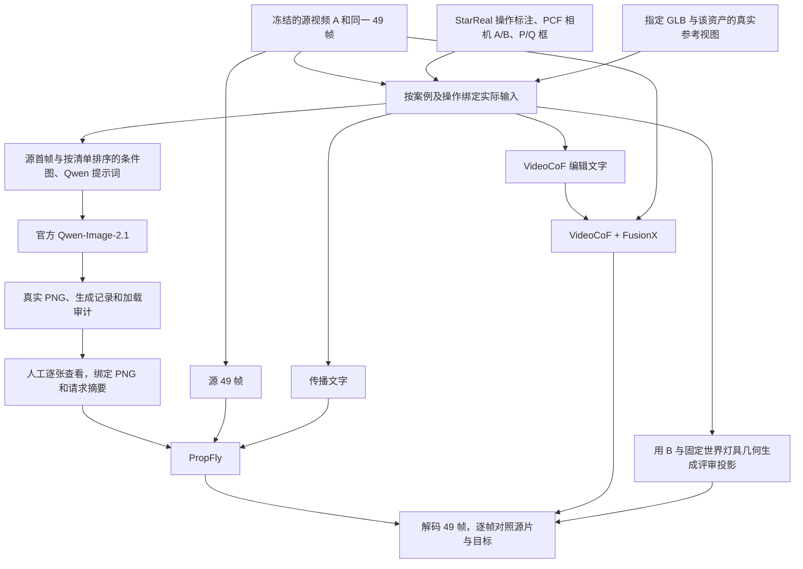

# 同一请求如何进入两条 baseline

**红 P** 表示完整原灯具的位置和范围，**蓝 Q** 表示目标灯具的位置和范围。两者均由包围盒的中心（center）、尺寸（size）和朝向（rotation）共同定义；NPZ 中名为 P、Q 的三维向量分别记录对应中心。红蓝投影重叠处显示黄色。PCF 的 B 轨迹描述期望的新相机运动。B 图中的框是灯具在该新视点的投影。源 A 的像素坐标不能直接当成 B 上的目标。

`geometry.py` 读取操作专属 NPZ 中的 K、w2c_A、w2c_B、P/Q、尺寸与旋转，依次用世界坐标、世界到相机变换、内参投影八个盒角；相机后方的框记录为空。支持独立几何 NPZ 及显式字段映射。原始数据含不同版本的文件结构，应通过所选请求／specification 指定包与 SHA，避免按案例号或目录次序猜测。绘图的默认标注画布为 1280×704，其他画布在请求中填写 `annotation_canvas_wh`。

`guides.py` 生成审核用板，按实际 `condition_images` 载入源图、角色/目标参考和资产参考，再展示 B 的 0/24/48 投影。只有请求清单里逐项列出、逐项校验的图像才传入 Qwen。原生传播与 CoF 的接口见首页。图审板、原 GLB、点云、SAM、相机标定和投影矩阵在这里用于备料和对照；模型输入日志分别记录其已接收的图像或文字。

纯替换使用以原 P 为中心的目标，新灯尺寸取指定资产的 Q_size。针对历史仅有移动＋替换方案而用户明确要求纯替换的配置，单独派生请求并使用明确的 P_rotation；继续保留原移动＋替换的蓝 Q 和原始来源。挂点、接触面、遮挡后结构需另有依据；OBB 中心本身没有这些含义。
